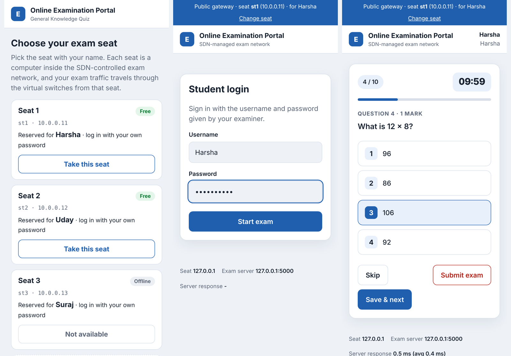
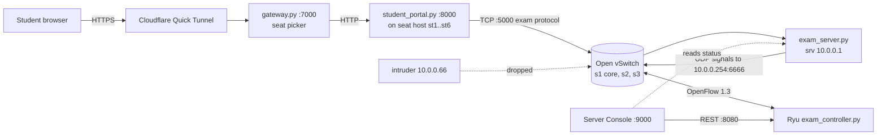
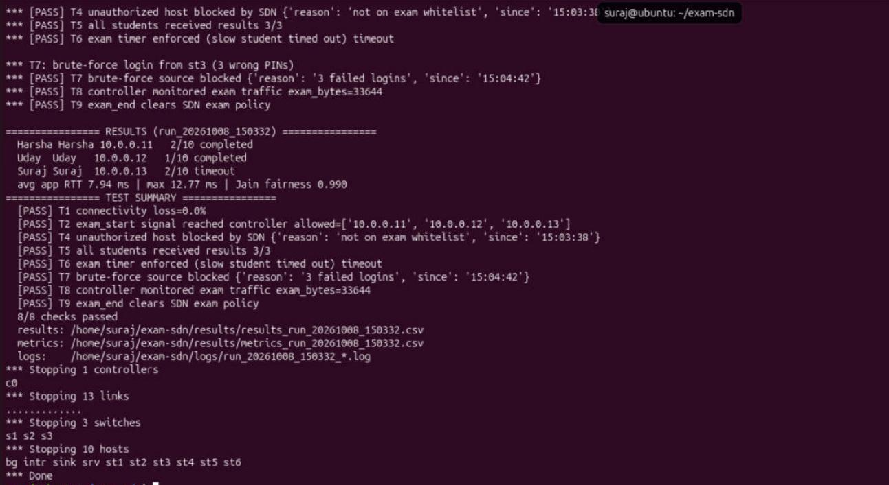
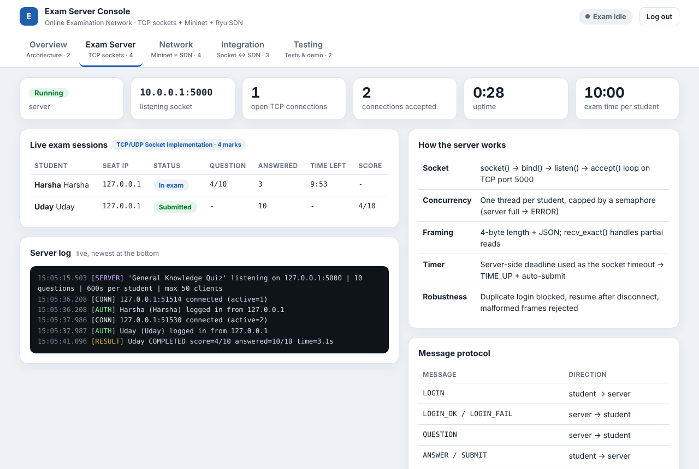
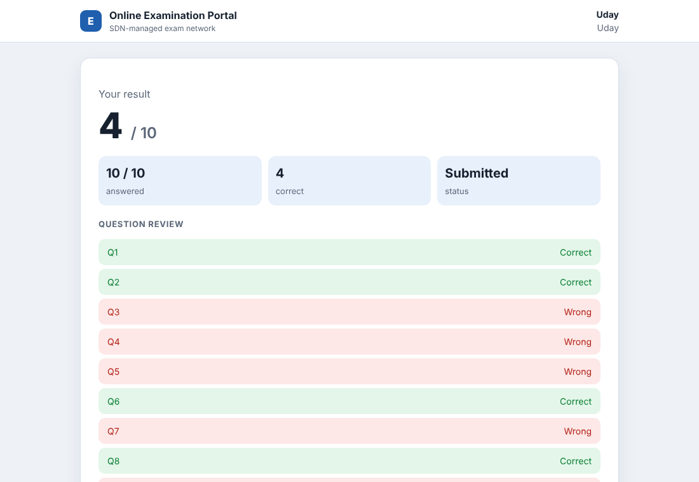

# Online Examination Network

**A multi-user online exam over raw TCP sockets, running on an SDN network that understands the exam.**


Students take a timed multiple-choice exam that runs over TCP sockets. The exam runs inside a Mininet network whose switches are programmed by our own Ryu controller. The exam server tells the controller what is happening (the exam started, a login failed, a student submitted), and the controller changes the network rules to match. It lets registered seats through, blocks intruders and password guessers, gives exam traffic a guaranteed-bandwidth queue, and monitors all traffic.

Built as a computer networks mini project (*SDN + Socket Programming, Problem #18: Online Examination Network*).

<p align="center">
  
</p>

---

## Contents

- [Highlights](#highlights)
- [Architecture](#architecture)
- [How the application and the network interact](#how-the-application-and-the-network-interact)
- [Getting started](#getting-started)
- [Running the demo](#running-the-demo)
- [Testing](#testing)
- [Results](#results)
- [Configuration](#configuration)
- [Project structure](#project-structure)
- [Documentation](#documentation)
- [Author](#author)
- [License](#license)

## Highlights

**Exam application (TCP sockets, Python standard library only)**
- Concurrent server: one thread per student, capped by a semaphore, with a clean "server full" error
- Length-prefixed JSON protocol (4-byte length + JSON) and a `recv_exact` loop that handles partial reads
- Login, one question at a time, answer key kept on the server, automatic grading and a CSV of results
- Timer enforced by the server, using the remaining time as the socket timeout, with `TIME_UP` and auto-submit
- Resume after a disconnect with the original deadline; duplicate logins and re-submissions rejected
- Round-trip time measured for every request, and Jain's fairness index computed across students

**SDN network (Ryu, OpenFlow 1.3, Mininet, Open vSwitch)**
- Campus-style topology: a core switch and two lab switches, with 10 Mbps bottleneck core links
- Exam mode driven by events from the application, not by static configuration
- Seat whitelist: a host not assigned to the exam is dropped at its first TCP SYN
- Brute-force protection: after 3 failed logins the source IP is blocked on every switch
- Exam flows placed in a guaranteed queue (at least 8 Mbps) while other traffic stays best-effort
- Flow and port statistics every 5 s, split into exam and background bytes, with congestion detection
- REST API for status, statistics, flow tables, events and manual block/unblock

**Web layer (HTTP written on raw sockets, no framework)**
- Student portal on every seat host: login, live countdown, auto-submit, result with a review of each question
- Server Console for examiners: password protected, with live sessions, topology, flow tables, the app-to-SDN event timeline and system checks
- Optional public access: free Cloudflare Quick Tunnels plus a seat-picking gateway, so classmates can join from their phones

## Architecture



Every student portal runs **on its seat host inside Mininet**, so each exam connection really comes from that seat's IP address and crosses the SDN switches. That is what makes the whitelist, the blocking and the priority queues meaningful.

```
                    srv 10.0.0.1 (exam server)      bg 10.0.0.99 (background traffic)
                              \                    /
                                    s1 (core)
                     10 Mbps, q0/q1 /         \ 10 Mbps, q0/q1
                         s2 (Lab A)             s3 (Lab B)
     st1 .11  st2 .12  st3 .13  intr .66        st4 .14  st5 .15  st6 .16
     sink .98  desktop .200                     (seats not assigned to the exam)
```

## How the application and the network interact

The exam server sends small JSON datagrams to the virtual address `10.0.0.254:6666`. A priority-400 rule on every switch hands them to the controller, which also answers ARP for that address itself. Signals carry a shared token, and every event except `exam_start` is accepted only from the registered server IP.

| Application event | Controller reaction |
|---|---|
| `exam_start` (server IP, port, allowed seats; repeated as a heartbeat) | Enter exam mode, store the whitelist, flush old flows so new ones get queues; a new run id resets per-exam state |
| First SYN to the exam port from a non-whitelisted IP | Install a priority-300 drop rule on all switches |
| `auth_fail` with count ≥ 3 | Block that source IP |
| `student_login` / `student_submit` | Track active students and results |
| `exam_end` | Leave exam mode; remove blocks and queue assignments |

**Flow table**

| Priority | Cookie | Match | Action |
|---|---|---|---|
| 400 | `0xE4` | UDP to 10.0.0.254:6666, ARP for 10.0.0.254 | to controller |
| 300 | `0xE3` | blocked source → exam server | drop |
| 100 | `0xE1` | exact TCP 5-tuple on port 5000 | `set_queue:1`, output |
| 10 | `0xE2` | other IPv4 5-tuple | `set_queue:0`, output |
| 5 | `0xE5` | L2 (ARP and others) | output |
| 0 | — | table-miss | to controller |

## Getting started

**Requirements:** Ubuntu 22.04, 24.04 or 26.04, on a VM or bare metal, with sudo access. Tested on Ubuntu 26.04 in VirtualBox.

```bash
git clone https://github.com/SurajCB/Online-Examination-Network.git
cd Online-Examination-Network
./scripts/install.sh
```

`install.sh` installs Mininet, Open vSwitch, iperf and qrencode, plus `cloudflared` for the optional public links. Ryu does not run on recent Python releases, so the script creates a separate Python 3.9 environment at `~/ryu-venv` (using `uv`) and pins `setuptools==67.6.1`, `eventlet==0.30.2` and `dnspython<2`. `run_controller.sh` activates that environment automatically.

The exam application itself only needs the Python standard library.

## Running the demo

Use three terminals, all in the repository folder.

```bash
# Terminal 1: SDN controller
./scripts/run_controller.sh

# Terminal 2: Mininet network, exam server, seat portals and Server Console
./scripts/run_portal.sh            # prints the console password, then the mininet> prompt

# Terminal 3 (optional): public links for phones
./scripts/run_public.sh            # prints the student link, console link and a QR code
```

Without the public links, open Firefox on the Ubuntu desktop:

| URL | What |
|---|---|
| `http://localhost:9000` | Server Console (password from Terminal 2, also in `logs/console_password.txt`) |
| `http://10.0.0.11:8000` … `10.0.0.13:8000` | Seats of the three demo students |
| `http://10.0.0.66:8000` | Intruder seat: the SDN blocks it |

**Demo accounts** (sample data in `data/students.json`, for demonstration only):

| Username | Password | Seat |
|---|---|---|
| Harsha | `Harsha@123` | st1 · 10.0.0.11 |
| Uday | `Uday@123` | st2 · 10.0.0.12 |
| Suraj | `Suraj@123` | st3 · 10.0.0.13 |

**Stopping:** type `exit` at `mininet>` and press `Ctrl+C` in the other terminals. If something is left over, run `./scripts/cleanup_net.sh`. Avoid `sudo mn -c` while the controller is running, because it also kills Ryu.

<details>
<summary><b>Running it by hand in the Mininet CLI</b></summary>

```bash
sudo python3 topology/exam_topo.py --cli
mininet> srv python3 app/exam_server.py --duration 180 &
mininet> st1 python3 app/exam_client.py --id Harsha --pin 'Harsha@123'          # interactive
mininet> st2 python3 app/exam_client.py --id Uday --pin 'Uday@123' --auto       # automatic
mininet> intr python3 app/exam_client.py --id Harsha --pin 'Harsha@123'         # blocked
mininet> sh ovs-ofctl -O OpenFlow13 dump-flows s1
$ curl localhost:8080/exam/status
```
</details>

## Testing

```bash
python3 tests/test_local.py                                       # 14 tests, no Mininet needed
~/ryu-venv/bin/python tests/test_controller.py                    # 12 controller tests with a mocked switch
./scripts/run_demo.sh                                             # end-to-end Mininet run with PASS/FAIL checks
```

| Check | Scenario | Pass condition |
|---|---|---|
| T1 | `pingall` | 0 % loss |
| T2 | Exam server starts | Controller reports `exam_active` with the whitelist |
| T3 / T5 | Three clients at once | All connect, finish and get a result |
| T4 | Client on the intruder host | Dropped by the SDN, listed as blocked |
| T6 | Slow student | Server times them out |
| T7 | Three wrong passwords | Source IP blocked |
| T8 | Monitoring | Exam bytes counted by the controller |
| T9 | Exam ends | Exam mode off, blocks removed |

Unit tests run on every push through GitHub Actions (`.github/workflows/tests.yml`).

## Results

End-to-end run in Mininet on Ubuntu 26.04 (VirtualBox):

| Metric | Value |
|---|---|
| Automated checks | **8 / 8 passed** |
| Average application RTT | **7.94 ms** |
| Maximum RTT | 12.77 ms |
| Jain's fairness index | **0.990** |

<p align="center">
  
</p>

<p align="center">
  
  
</p>
<p align="center"><sub>Console and result screenshots come from a local preview run, so seat addresses show as 127.0.0.1.</sub></p>

Performance experiments that compare SDN prioritisation with a baseline, with and without congestion, are described in [docs/TEST_PLAN.md](docs/TEST_PLAN.md). Use `tools/analyze.py` to produce the response time and fairness summary and plots.

## Configuration

| Component | Option | Default |
|---|---|---|
| Exam server | `--duration`, `--max-clients`, `--shuffle`, `--strict-seat`, `--no-sdn` | 120 s (600 s in portal mode), 50 clients |
| Controller (env) | `EXAM_PRIORITIZE` (0 = baseline), `EXAM_CONGESTION_MBPS`, `EXAM_BLOCK_THRESHOLD`, `EXAM_MONITOR_INTERVAL` | 1, 5, 3, 5 s |
| Signalling (env) | `EXAM_SDN_TOKEN`: shared secret between server and controller | demo value; change it for real use |
| Server Console (env) | `EXAM_CONSOLE_PASSWORD` | random, printed at start |
| Topology | `--demo`, `--portal`, `--cli`, `--congestion`, `--bg-rate`, `--core-bw`, `--no-qos`, `--tag` | 10 Mbps core links |

**Controller REST API** (port 8080): `GET /exam/status`, `/exam/stats`, `/exam/flows`, `/exam/events`; `POST /exam/block/<ip>`, `/exam/unblock/<ip>`, `/exam/start`, `/exam/end`.

## Project structure

```
Online-Examination-Network/
├── app/
│   ├── protocol.py          # framing: 4-byte length + JSON, recv_exact
│   ├── exam_server.py       # concurrent TCP exam server, timer, grading
│   ├── exam_client.py       # terminal client (interactive or --auto)
│   ├── sdn_signal.py        # application → controller UDP signals
│   ├── minihttp.py          # small HTTP/1.1 server on raw sockets
│   ├── student_portal.py    # seat portal: HTTP ↔ TCP exam protocol
│   ├── gateway.py           # public seat picker / reverse proxy
│   ├── admin_portal.py      # Server Console backend
│   └── web/                 # student.html, seats.html, console.html
├── controller/exam_controller.py   # Ryu app: policy, queues, monitoring, REST
├── topology/exam_topo.py           # Mininet topology, QoS, demo and portal modes
├── data/                    # questions.json, students.json (demo data)
├── scripts/                 # install, run_*, cleanup_net, status
├── tests/                   # test_local.py, test_controller.py
├── tools/analyze.py         # RTT and Jain fairness analysis
└── docs/                    # architecture, test plan, team plan, images
```

## Documentation

- [docs/ARCHITECTURE.md](docs/ARCHITECTURE.md): problem, objectives, protocol, session state machine, flow-table design
- [docs/TEST_PLAN.md](docs/TEST_PLAN.md): unit tests, Mininet scenarios, web portal checks, performance experiments

## Author

**SURAJ CB** · [@SurajCB](https://github.com/SurajCB)

## Notes

- `data/students.json` contains **sample demo accounts only**. Never commit real student credentials.
- Quick Tunnel links are temporary, change every time they start and come with no uptime guarantee. Some campus networks block them, so a phone hotspot works as a fallback.
- This project was built for teaching and demonstration. It is not a hardened exam platform.

## License

Released under the [MIT License](LICENSE).
