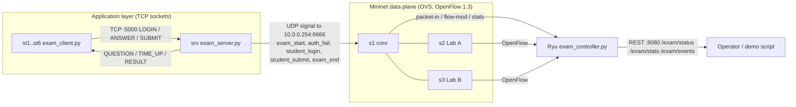

# Online Examination Network — Problem Understanding & Architecture

## 1. Problem statement (Project #18)

Build a multi-user online examination application where students connect to an exam server through **TCP sockets**, and an **SDN network** (Mininet + Ryu/OpenFlow 1.3) monitors and manages the examination traffic.

Required features from the problem sheet and where each one lives:

| Requirement | Implementation |
|---|---|
| Concurrent TCP clients | `exam_server.py`: low-level `socket` accept loop, one thread per client, bounded by a semaphore (`--max-clients`) |
| Deliver examination questions | `QUESTION` messages sent one at a time; answer key never leaves the server |
| Answer submission | `ANSWER` / `SUBMIT` messages, validated against the expected question id |
| Examination timer | Per-student deadline enforced by the server (socket timeout = remaining time), with `TIME_UP` + auto-submit |
| Calculate results | Server grades and sends `RESULT`, appends to `results/results_*.csv` |
| Monitor application traffic | Controller polls flow/port statistics every 5 s, splits exam vs other bytes by flow cookie, logs to `logs/controller_stats.csv`, exposes `/exam/stats` |
| Test under congestion | `--congestion` mode floods the core link with iperf UDP traffic (D2) |
| Evaluate response time & fairness | Clients record per-request RTT; `tools/analyze.py` computes avg/p95/max RTT and Jain's fairness index (D2) |

## 2. Objectives

1. Reliable, concurrent exam delivery over TCP with a clear application protocol.
2. An SDN controller that knows **when an exam is running** (from application events) and enforces exam policy: only seat-assigned hosts can reach the exam server, brute-force sources are blocked, and exam traffic is prioritised.
3. Continuous monitoring of exam traffic vs background traffic, with congestion detection.
4. Measurable latency and fairness, compared against a baseline (no SDN prioritisation) in D2.

## 3. System architecture



### Topology

```
                 +---------------- Ryu controller (127.0.0.1:6653, REST :8080)
                 |
   srv 10.0.0.1 -+- s1 (core) -+- bg 10.0.0.99 (background traffic source)
                    |      |
           10 Mbps  |      |  10 Mbps   <- bottleneck core links (HTB queues q0/q1)
                    |      |
   Lab A:  s2 ------+      +------ s3 : Lab B
   st1 10.0.0.11              st4 10.0.0.14
   st2 10.0.0.12              st5 10.0.0.15
   st3 10.0.0.13              st6 10.0.0.16
   intr 10.0.0.66 (unauthorised)
   sink 10.0.0.98 (background traffic sink)
```

Host links are 100 Mbps; the two core links are capped at 10 Mbps so congestion is reproducible. Each core port has two OVS `linux-htb` queues: **q0** best effort and **q1** exam traffic (minimum 8 Mbps guaranteed).

### Components

| Component | File | Role |
|---|---|---|
| Protocol | `app/protocol.py` | Length-prefixed JSON framing over TCP (4-byte big-endian length + UTF-8 JSON), `recv_exact` loop for partial reads, 64 KB frame limit, typed errors |
| Exam server | `app/exam_server.py` | Accept loop, thread per client, authentication, sessions, timer, grading, results CSV, SDN signalling |
| Exam client | `app/exam_client.py` | Interactive mode (uses `select` on stdin + socket so `TIME_UP` arrives immediately) and `--auto` mode for load tests; connect retry with exponential backoff; per-request RTT metrics |
| SDN signaller | `app/sdn_signal.py` | Sends application events as UDP datagrams to the virtual address 10.0.0.254:6666, with a heartbeat |
| Controller | `controller/exam_controller.py` | Ryu app: L2 learning + L3/L4 microflows, exam policy, blocking, QoS queue selection, monitoring, REST API |
| Topology | `topology/exam_topo.py` | Mininet topology, OVS QoS queues, root-namespace link (10.0.0.200) for the browser, automated D1 demo + test checks, `--portal` mode |
| HTTP layer | `app/minihttp.py` | Small HTTP/1.1 server written on raw sockets (thread per connection, Content-Length bodies, size limits) |
| Student portal | `app/student_portal.py`, `app/web/student.html` | Runs on each seat host; the browser talks HTTP to it, and it holds one TCP exam session to the server using the same protocol as the CLI client |
| Server Console | `app/admin_portal.py`, `app/web/console.html` | Runs on the Ubuntu desktop; combines controller REST data, the roster and the results file; block/unblock buttons call the controller |

### Web portal path

```
Browser (Ubuntu desktop, 10.0.0.200) --HTTP--> s2 --> student portal on st1 (10.0.0.11:8000)
student portal on st1 --TCP exam protocol :5000--> s2 --> s1 --> srv (10.0.0.1)
Browser --HTTP--> Server Console (:9000, password) --REST--> Ryu (127.0.0.1:8080); it also reads logs/server_status.json (written by the exam server every second) and logs/topology.json (written by the topology)
```

Public demo path (optional): `phone --HTTPS--> Cloudflare Quick Tunnel --> gateway.py on the Ubuntu desktop (port 7000) --HTTP over 10.0.0.200--> chosen seat's portal --TCP--> srv`. The gateway only picks a seat (cookie) and forwards requests; the exam connection is still made by the seat inside Mininet.

The portal lives on the seat host, so the exam connection really originates from the seat's IP. That keeps the whitelist, the brute-force blocking and the priority queues meaningful: the intruder seat's portal cannot reach the server at all.

## 4. Application protocol

Every message is `[4-byte length][JSON]` and carries `type` and `t` (sender timestamp). Responses echo the request's `t` in `echo_t`, so the client measures true application round-trip time.

| Direction | Type | Fields |
|---|---|---|
| C→S | `LOGIN` | `student_id`, `pin` |
| S→C | `LOGIN_OK` | `name`, `exam_title`, `total_questions`, `duration`, `remaining`, `resumed`, `answered` |
| S→C | `LOGIN_FAIL` | `reason` (invalid credentials, already submitted, already logged in, wrong seat) |
| S→C | `QUESTION` | `qid`, `index`, `total`, `text`, `options`, `marks`, `remaining` |
| C→S | `ANSWER` | `qid`, `choice` (0-based, `null` = skip) |
| C→S | `SUBMIT` | — |
| C→S / S→C | `PING` / `PONG` | `remaining` |
| S→C | `TIME_UP` | `message` |
| S→C | `RESULT` | `score`, `total`, `answered`, `status`, `details[]` |
| S→C | `ERROR` | `reason` |

### Session state machine (server)

```
CONNECTED --LOGIN ok--> ACTIVE --all answered / SUBMIT--> COMPLETED
    |                     |  \--deadline passed----------> TIMEOUT
    |                     \--socket closed--> DISCONNECTED --re-LOGIN before deadline--> ACTIVE (resumed)
    \--3 bad LOGINs--> closed (auth_fail signalled to SDN)
```

Robustness built in: duplicate login rejected, re-submission rejected, resume after disconnect keeps the original deadline, server full → `ERROR`, malformed frames → connection closed, unfinished sessions graded on shutdown.

## 5. Socket ↔ SDN integration

The exam server tells the network what is happening through **in-band UDP signals** to the virtual address `10.0.0.254:6666`. Each switch has a priority-400 rule that sends these packets (and ARP for 10.0.0.254) to the controller, which answers the ARP itself and parses the JSON payload. Signals carry a shared token, and anything except `exam_start` is only accepted from the registered server IP.

| App event | Controller reaction |
|---|---|
| `exam_start` (server IP, port, allowed seat IPs; repeated as a heartbeat) | Enter exam mode, store whitelist, flush old flows so new ones get QoS queues |
| TCP SYN to server:5000 from a non-whitelisted IP | Install priority-300 drop rule on all switches, log `blocked` |
| `auth_fail` with count ≥ 3 | Block that source IP (brute-force protection) |
| `student_login` / `student_submit` | Track active students and results for monitoring |
| `exam_end` | Leave exam mode, remove blocks and queue assignments |

## 6. Flow table design

| Priority | Cookie | Match | Action | Timeout |
|---|---|---|---|---|
| 400 | 0xE4 | UDP dst 10.0.0.254:6666, ARP tpa 10.0.0.254 | → controller | none |
| 400 | 0xE4 | IPv6 | drop | none |
| 300 | 0xE3 | ipv4_src = blocked IP, ipv4_dst = server | drop | until unblocked |
| 100 | 0xE1 | exact TCP 5-tuple with port 5000 | set_queue 1 (in exam mode), output | idle 60 s |
| 10 | 0xE2 | exact IPv4 5-tuple (other traffic) | set_queue 0 (in exam mode), output | idle 30 s |
| 5 | 0xE5 | in_port, eth_src, eth_dst, eth_type (ARP etc.) | output | idle 30 s |
| 0 | 0 | table-miss | → controller | none |

Cookies let the monitor sum bytes per traffic class from flow statistics; bytes from expired flows are added back from `FlowRemoved` messages so counters never go backwards.

## 7. Expected network behaviour

* Before the exam: plain learning-switch connectivity (pingall 0 % loss).
* Exam running: only the seats in `students.json` (st1–st3: Harsha, Uday, Suraj) reach srv:5000; st4–st6 and intr are dropped at their first SYN; exam flows show up under cookie 0xE1 with queue 1.
* Brute-force login from any host gets that host cut off from the server after the 3rd failure.
* Under background flooding of a core link (D2), exam flows keep their 8 Mbps guaranteed queue, so RTT stays low; in baseline mode (`EXAM_PRIORITIZE=0`) RTT rises and fairness drops. The controller logs a `congestion` event when non-exam traffic exceeds the threshold.
